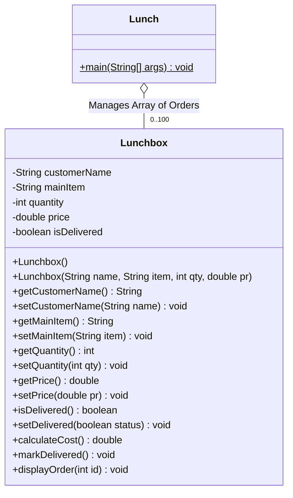

# Java Order Management & POS System

[](https://www.oracle.com/java/)
[](LICENSE)
[]()

A robust, object-oriented Point-of-Sale (POS) and order tracking system written in Java. Demonstrates in-memory object collection management, state mutation lifecycles, financial aggregation logic, cryptographically secure randomized promotional incentives (`SecureRandom`), and formatted reporting tables.

---

## 📋 Table of Contents

- [Overview](#overview)
- [Key Features](#key-features)
- [Software Architecture & Design](#software-architecture--design)
- [Core Skills Demonstrated](#core-skills-demonstrated)
- [Project Structure](#project-structure)
- [Getting Started](#getting-started)
  - [Prerequisites](#prerequisites)
  - [Compilation & Execution](#compilation--execution)
- [User Guide & Menu Options](#user-guide--menu-options)
- [Sample Execution](#sample-execution)
- [License](#license)

---

## 🌟 Overview

The **Java Order Management & POS System** simulates a commercial lunch order fulfillment platform. It provides an interactive CLI workflow allowing operators to record incoming customer orders, dynamically adjust line-item quantities, track delivery statuses, render tabular audit logs, and compute aggregate gross revenue in real time.

---

## ✨ Key Features

- **Full Order Lifecycle Management (CRUD)**:
  - **Create**: Add new customer orders with item selection, quantity, and unit price.
  - **Read**: Display all active orders in aligned, human-readable table views.
  - **Update**: Modify item quantities dynamically for existing orders by Order ID.
  - **Status Tracking**: Mark orders as `DELIVERED` or `PENDING` with delivery confirmation guards.
- **Financial Analytics Engine**: Computes sub-totals and cumulative revenue across all active records.
- **Cryptographically Secure Reward System**: Uses `java.security.SecureRandom` to grant randomized complimentary dessert promotions upon order creation.
- **Structured Table Visualizations**: Formatted tabular console outputs with consistent column widths, headers, and currency formatters (`$%,.2f`).
- **Defensive Error Handling**: Validation for invalid menu options and non-existent order lookups.

---

## 🏛️ Software Architecture & Design



---

## 🛠️ Core Skills Demonstrated

| Technical Competency | Description |
| :--- | :--- |
| **Array of Objects Management** | Managing structured memory arrays (`Lunchbox[]`) with zero-indexed tracking counters. |
| **Object-Oriented Encapsulation** | Constructor overloading (default & parameterized) and domain-specific mutators (`markDelivered()`). |
| **Secure Randomization** | Leveraging `java.security.SecureRandom` for unbiased cryptographic promotional allocation. |
| **Financial Computation** | Safe floating-point price calculations, item sub-totals, and grand totals formatted with standard currency notation. |
| **Interactive State Machine** | Menu-driven continuous execution loop with `switch-case` dispatching and graceful termination. |
| **Advanced Console Formatting** | High-density formatted tables with `System.out.printf` and string repetition dividers. |

---

## 📁 Project Structure

```text
java-order-management-pos-system/
├── Lunchbox.java       # Model entity handling single-order attributes, state, and cost logic
├── Lunch.java          # Main POS controller, menu loop, array management, and calculations
├── .gitignore          # Git exclusion rules for Java binaries and IDE files
├── LICENSE             # MIT License
└── README.md           # Professional project documentation
```

---

## 🚀 Getting Started

### Prerequisites

- **Java Development Kit (JDK)**: Version 8 or higher (`javac` and `java` available in PATH).

### Compilation & Execution

1. **Clone the repository:**
   ```bash
   git clone https://github.com/<your-username>/java-order-management-pos-system.git
   cd java-order-management-pos-system
   ```

2. **Compile the Java source files:**
   ```bash
   javac Lunch.java Lunchbox.java
   ```

3. **Run the POS system:**
   ```bash
   java Lunch
   ```

---

## 📖 User Guide & Menu Options

Upon launching the application, the operator is presented with the following options:

1. **`1. Add a NEW order!`** - Prompts for customer name, main item, quantity, and unit price. Grants a complimentary dessert.
2. **`2. Add quantity to an order`** - Displays current orders and updates existing quantities by Order ID.
3. **`3. Mark an order as delivered`** - Updates order delivery status from Pending to Delivered.
4. **`4. View all lunch orders`** - Generates an aligned tabular summary report of all orders.
5. **`5. Calculate total sales`** - Sums and displays the total revenue from all orders.
6. **`6. Exit`** - Gracefully terminates the program.

---

## 🖥️ Sample Execution

```text
==============================
   LUNCH ORDER TRACKER     
==============================
1. Add a NEW order!
2. Add quantity to an order
3. Mark an order as delivered
4. View all lunch orders
5. Calculate total sales
6. Exit
==============================

Choice: 4

=====================================================================================
ID   | CUSTOMER                  | ITEM       | QTY   | TOTAL         | STATUS         
-------------------------------------------------------------------------------------
#1   | Alexander Pierce          | Steak      | 2     | $48.00        | Delivered      
#2   | Sophia Martinez           | Pasta      | 3     | $42.75        | Not Delivered  
=====================================================================================

Choice: 5

TOTAL SALES OF ALL ORDERS: $90.75
```

---

## 📄 License

This project is open-source and licensed under the [MIT License](LICENSE).
